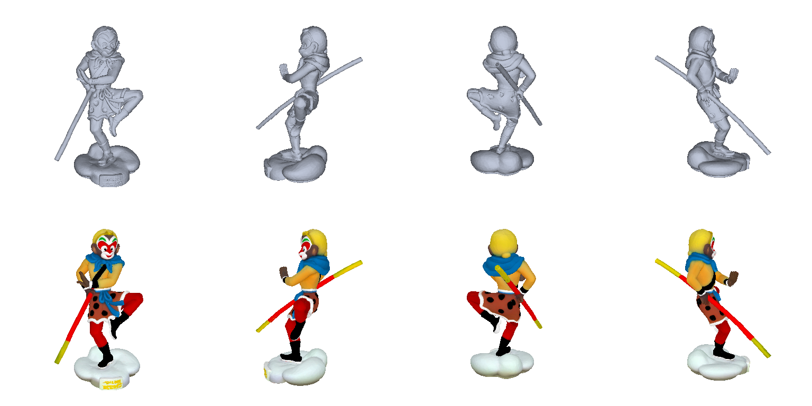

# ComfyUI-UniForge3D

ComfyUI nodes for [UniForge3D](https://github.com/xibushu/UniForge3D) (multi-view images → textured 3D asset),
ported to run **without any CUDA-only extension**, so it runs on AMD ROCm GPUs. It was developed and tested on a
Strix Halo APU (Radeon 8060S, gfx1151) with PyTorch 2.13 + ROCm 10.1.

UniForge3D upstream needs CuMesh, FlexGEMM, nvdiffrast, o-voxel, flash-attn and peft, the first four of which only
build for NVIDIA. This port replaces them with pure-PyTorch code, most of it already in ComfyUI's native TRELLIS.2
and mesh-processing implementation. The details are in [docs/AMD_PORT.md](docs/AMD_PORT.md).



## Nodes

| Node | Purpose |
|---|---|
| **UniForge3D Loader** | Picks a weight folder under `models/uniforge3d/` and the DINOv3 ViT-L ClipVision. Weights load lazily, one stage at a time. |
| **UniForge3D Views** | Collects up to 6 views of any size with their masks (chain for more). The first view is the anchor. |
| **UniForge3D Generate** | Runs the pipeline up to `geometry_512`, `geometry_1024` or `textured`, and outputs a native `MESH`. |

The `MESH` output works with the native nodes: Save GLB, Preview 3D, Remesh, Decimate, Unwrap, Bake and so on.

`mask_mode` on **Views**:

- `inverted (LoadImage alpha)`: wire **LoadImage**'s `MASK` from RGBA PNGs. LoadImage's mask is 1 where the PNG is transparent.
- `foreground`: masks where 1 means the object, as background-removal nodes produce.
- `none`: the whole image is the object.

## Installation

1. Clone into `ComfyUI/custom_nodes/`. There are no pip requirements beyond ComfyUI's own: torch, numpy, trimesh,
   opencv, scipy, Pillow, safetensors.
2. Weights go in `ComfyUI/models/uniforge3d/UniForge3D/` (any folder name containing `pipeline.json` works):

   ```text
   UniForge3D/
   ├── pipeline.json                      # from huggingface.co/xibushu/UniForge3D
   ├── uniforge3d/{stage1,shape512,shape1024,texture,vggt}/*.pt
   └── external/
       ├── microsoft/TRELLIS.2-4B/ckpts/ss_flow_img_dit_1_3B_64_bf16.{json,safetensors}
       ├── microsoft/TRELLIS.2-4B/ckpts/shape_dec_next_dc_f16c32_fp16.{json,safetensors}
       ├── microsoft/TRELLIS.2-4B/ckpts/tex_dec_next_dc_f16c32_fp16.{json,safetensors}
       └── microsoft/TRELLIS-image-large/ckpts/ss_dec_conv3d_16l8_fp16.{json,safetensors}
   ```

   The revisions match upstream `pipeline.json` (TRELLIS.2-4B `af44b45f`, TRELLIS-image-large `25e0d31f`).
   The total is about 32 GB, all fp32 except the TRELLIS files.
3. DINOv3 ViT-L/16: use the same `clip_vision/dino_v3_L_naf_fp32.safetensors` that the native TRELLIS.2 and Pixal3D
   templates use. The gated `facebook/dinov3-vitl16-pretrain-lvd1689m` download is not needed.
4. Load `workflows/uniforge3d_multiview.json`. It wires 4 × LoadImage → Views → Generate → Save GLB.

## Measured on gfx1151 (Radeon 8060S, 128 GB unified memory)

These are from upstream example `case01` (4 views) at the default settings: seed 42, steps 12/20/20/20, 2048² texture, 1M faces.

| Output | Time | Peak GPU memory |
|---|---|---|
| `geometry_512` | 145 s | 10.9 GiB |
| `textured` (512 → 1024 → PBR) | 450 s | 13.5 GiB |

Times include loading each stage's weights from NVMe. `keep_models_in_ram` keeps the about 31 GB of stage weights in
system RAM between runs.

## Coexistence with TRELLIS.2 / Pixal3D

The pack patches nothing in ComfyUI or in other node packs. It only adds nodes, and it restores the global RNG state after
each run. This was tested in one server process: UniForge3D, then TRELLIS.2 512, then Pixal3D 512. The raw meshes from
TRELLIS.2 and Pixal3D were byte-identical to runs without the pack. Details are in [docs/AMD_PORT.md](docs/AMD_PORT.md).

## Optional native extensions

FlexGEMM builds for ROCm unmodified, and CuMesh builds with `patches/cumesh-hip.patch`.
`scripts/build_native_rocm.sh <out_dir> gfx1151` builds wheels for both. Set `UNIFORGE3D_NATIVE_EXT=auto` to use them.

Per op they are 4–17× faster. End to end they are not faster: 459 s warm against 450 s, because DiT sampling dominates.
Their value is mesh processing that matches upstream exactly. nvdiffrast does not build. It would need a real port, and it
is not needed here.

## Differences from upstream

- **UV unwrapping** uses ComfyUI's chart segmentation, parameterization and packing instead of CuMesh's
  xatlas-based atlas. The charts differ, but the baking is the same.
- **Decimation, remeshing and hole filling** use ComfyUI's re-implementations of the CuMesh algorithms
  (midpoint QEM, UDF narrow-band dual contouring). The topology is close to upstream but not bit-identical.
- **Attention** uses PyTorch SDPA per sequence. On gfx1151 this is about 1.7× faster than flash-attn's Triton varlen
  kernel on UniForge's routed-attention shapes. Both are numerically equivalent.
- **LoRA adapters** are merged into the base weights at load time instead of using `peft`.
- **Background removal**: BRIA RMBG-2.0 is not bundled. Use RGBA inputs or any ComfyUI background-removal node.
- `drop_inner_shell` is an opt-in extra. It removes the inside-out offset shell that UDF remeshing leaves inside
  closed parts. It is off by default to match upstream.

## Tests

```bash
PYTHONPATH=/path/to/ComfyUI:. python tests/test_compat.py -v
```

The tests check each replacement against an independent reference on the GPU:

- sparse conv against dense `conv3d`
- grid sampling against FlexGEMM's CUDA kernel semantics and against `F.grid_sample`
- merged LoRA against unmerged LoRA
- varlen SDPA against explicit softmax
- the BVH against brute force
- hole filling, remeshing, decimation, and UV unwrap plus rasterization

## License

- **Code:** MIT, both this port and upstream UniForge3D. See `LICENSE` and `LICENSE.UniForge3D`. At runtime it imports
  ComfyUI, which is GPL-3.0.
- **Weights:** these have their own licenses.
  - The UniForge3D checkpoints are **CC BY-NC 4.0**, because they are VGGT-derived.
  - Check the TRELLIS and DINOv3 licenses before any commercial use.

Citation: Chen et al., *UniForge3D: Joint 3D Reconstruction and Generation in a Shared Anchor-Guided Space*,
arXiv:2610.15357.
